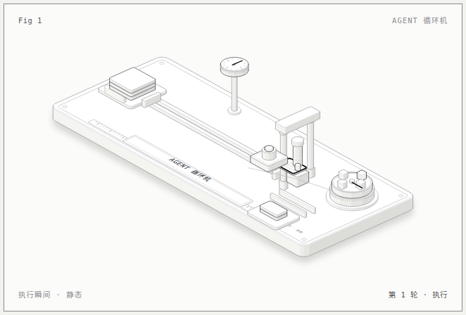

# Agent 循环机（中文示例）

把 **AI Agent 循环：感知 → 决策 → 执行 → 观察** 画成一台真实的机械。

| 概念 | 机器部件 |
|---|---|
| 感知（新任务进来） | 左侧进料斗里的任务卡片堆 |
| 决策（读任务、选工具） | 导轨上的读卡器 + 右上角工具选择转盘 |
| 执行（动手干活） | 导轨末端的压机，压头落下 = 执行 |
| 观察（看结果、记轮次） | 右下出料滑槽 + 结果票据 + 左上轮次计数表盘 |

## 跑起来

```bash
node build.mjs                 # 生成 agent-loop.html（动画版，浏览器打开看）
node build.mjs --static=0.68   # 生成 agent-loop-static.html（定格在"执行"那一帧）
node ../../scripts/capture.mjs agent-loop.html --out preview.png
```

## 出多平台配图

```bash
node build.mjs --static=0.68   # 先烘焙静态帧（定格在"执行"那一帧）
node ../../scripts/render-static.mjs agent-loop-static.html \
  --aspect 16:9 --title "Agent 循环机" --out /tmp/agent-16x9.png
```
注意：render-static 的输入必须是 `--static` 烘焙出的静态 HTML，直接传动画版会抓到随机帧。

比例可选 `16:9`（X/B站）`1:1`（IG/Threads/FB）`4:5`（IG）`3:4`（小红书）`9:16`（TikTok），
非 16:9 会自动套版：母版图完整保留，上下加标题区，不硬裁。

## 照着改

1. 改顶部 `MACHINE` 常量：机器各部件的尺寸和位置。
2. 改 `story(t)`：时间轴分段，决定每个部件什么时候动。
3. 改 `readout`：中文状态文案，格式固定为"第 N 轮 · 阶段"。
4. 改铭牌：`plateLabel("AGENT 循环机")` 换成你的标题。


